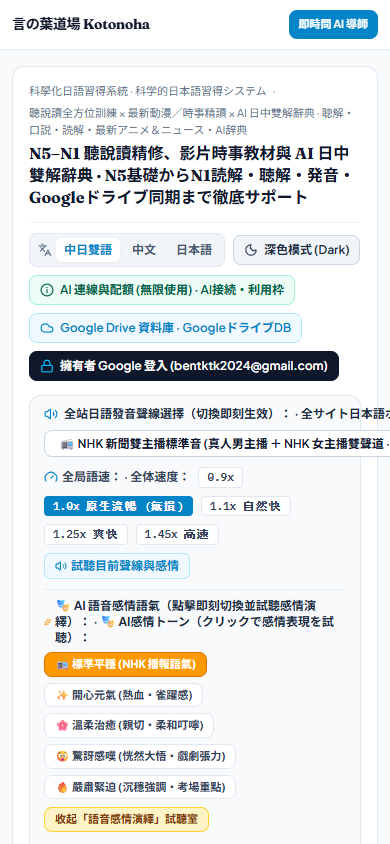
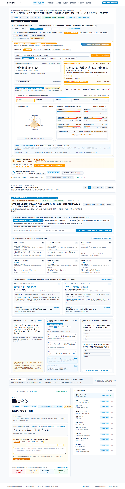
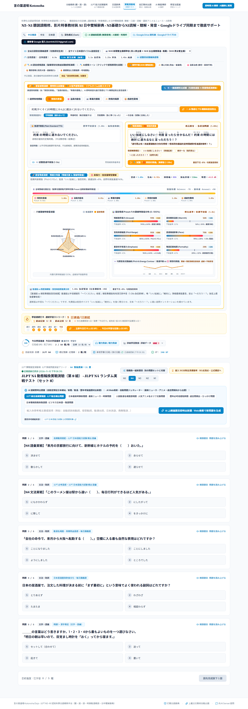
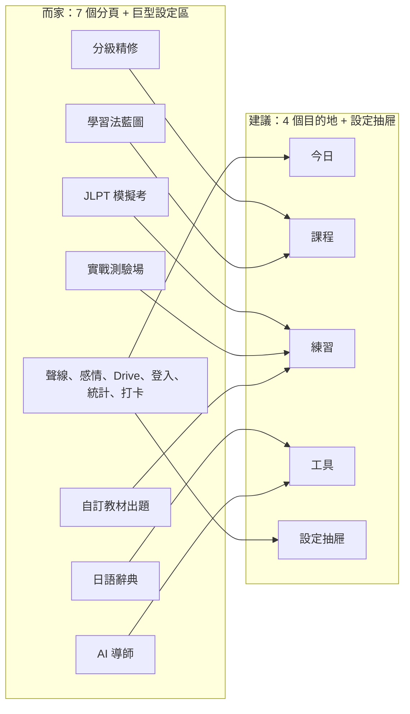

# 言の葉道場 Kotonoha — 產品檢討與重新設計建議

> [!IMPORTANT]
> **一句總結**：功能做得好多，但係「學習」本身俾設定、炫技功能同宣傳字眼淹沒咗。打開個 app，第一個畫面完全見唔到要學嘅嘢；而核心教材每個級別只有 4 個生字、2 個文法。問題唔係外觀唔夠靚，而係產品重心放錯咗位。

## 1. 實測數據

我用 Chrome 喺桌面 1440px 同手機 390px 逐個分頁截圖量度：

| 指標 | 實測結果 | 正常學習 app 大概 |
|---|---|---|
| 手機首頁總長度 | 約 13,000px，即係捲 15 個螢幕 | 1 至 2 個螢幕 |
| 每個分頁頂部固定區塊 | 約 2,100 至 2,500px 嘅設定、聲線、感情試聽室、打卡、統計 | 0，設定應該收埋 |
| 打開後第一個畫面有幾多學習內容 | 0%，全部係語言切換、深色模式、AI 配額、Drive、擁有者登入、聲線、語速、感情 | 今日要溫嘅嘢 |
| 主導航分頁 | 7 個，其中 4 個都係做題 | 3 至 4 個 |
| 核心教材 | 每級 4 個生字、2 個文法、1 篇閱讀、3 條測驗題；全 app 加埋約 110 個詞 | N5 已經要約 800 詞，N1 約 10,000 詞 |
| 字卡有冇遮答案 | 冇，生字同意思一齊顯示 | 先睇字、自己諗、再揭答案 |
| 有冇「今日到期要溫」清單 | 有記錄 `nextReviewAt`，但介面冇用佢 | SRS 嘅核心 |

````carousel

<!-- slide -->

<!-- slide -->

<!-- slide -->

````

---

## 2. 以學習者角度睇：最大嘅 6 個問題

### ① 唔知「今日應該做咩」
打開之後見到 7 個分頁、幾十粒掣，但冇一個清楚嘅「開始」。學語言最難係每日堅持，app 應該幫我決定，唔係叫我自己揀。

### ② 字卡違反「主動回想」
[StudyStage.tsx](file:///C:/Users/bensh/.gemini/antigravity/scratch/Nihongo/src/components/StudyStage.tsx) 嘅字卡將漢字、讀音、意思、例句同時顯示，再叫我評「記得／唔記得」。答案已經擺喺面前，評分就冇意義，SM-2 計出嚟嘅間隔都唔準。

### ③ 間隔重複得個名
[srsEngine.ts](file:///C:/Users/bensh/.gemini/antigravity/scratch/Nihongo/src/utils/srsEngine.ts#L117-L188) 嘅 SM-2 演算法本身寫得唔錯，但冇任何畫面話我知「今日有 12 張到期」。每日目標計嘅係「總共學過幾多張」，唔係「今日溫咗幾多張」，所以第二日開始個進度圈已經唔會郁。

### ④ 教材量同宣傳差好遠
學習法藍圖寫住「N5 要求 800 詞、N1 要求 10,000 詞」，但下面顯示「已建立記憶卡 2 張、每級 4 個核心單元」。用家好快會發現冇嘢可以學。

### ⑤ 炫技功能搶咗主角
「語音感情演繹試聽室」預設展開，有雷達圖、六維聲線分佈、音高曲線，仲有「憤怒的責備」聲線。對 N4 學習者完全冇幫助，但佔咗每個分頁最大嘅位置。同類嘅仲有 Antigravity 技能同步、Google Drive 資料庫、AI 配額說明。

### ⑥ 雙語並排令資訊量加倍
預設「中日雙語」，所以每個標題、每粒掣都寫兩次，例如「全站日語發音聲線選擇（切換即刻生效）：・全サイト日本語ボイス＆速度設定：」。介面語言應該揀一種；日文只應該出現喺「要學嘅內容」入面。

---

## 3. 以產品角度睇：信任、安全同成本

> [!WARNING]
> 以下幾點如果將來要公開俾其他人用，一定要先處理。

| 問題 | 證據 | 風險 | 建議 |
|---|---|---|---|
| 聲線名稱誤導 | 介面寫「NHK 新聞雙主播標準音・真人男主播」，實際係經非官方 `tiktok-tts.weilnet.workers.dev` 同 Google Translate 非公開接口合成 | 隨時失效、可能違反服務條款、用家覺得被騙 | 轉用已經有嘅 Gemini TTS 模型，名稱老實寫「AI 男聲／AI 女聲」 |
| AI API 完全公開 | [server.ts](file:///C:/Users/bensh/.gemini/antigravity/scratch/Nihongo/server.ts) 17 條 `/api/ai/*` 路由冇任何驗證 | 部署出去任何人都可以用你個 Gemini Key | 伺服器端驗證 Firebase 登入或者加速率限制 |
| 擁有者門禁只喺前端 | 門禁狀態存喺 `localStorage`，比對 email 字串 | 開 DevTools 改一個值就入到 | 改用 Firebase Auth 真登入，伺服器驗 token |
| 擁有者 email 顯示喺主畫面 | 「擁有者 Google 登入 bentktk2024@gmail.com」 | 私隱外洩 | 收入設定，唔顯示 email |
| 誇大宣傳字眼 | 「無限使用」、「0 秒自動無縫切換」、「絕不鎖死」、「1.0x 原生流暢 無損」、「全真題庫」 | 降低專業感 | 刪走；題目叫「模擬題」 |

---

## 4. 程式結構問題

| 檔案 | 行數 | 問題 |
|---|---|---|
| [App.tsx](file:///C:/Users/bensh/.gemini/antigravity/scratch/Nihongo/src/App.tsx) | 1,708 | 30 幾個 state 全部擺喺一個 component；導航項目定義咗兩次 |
| [StudyStage.tsx](file:///C:/Users/bensh/.gemini/antigravity/scratch/Nihongo/src/components/StudyStage.tsx) | 3,023 | 7 種學習模式塞喺同一個檔 |
| [srsEngine.ts](file:///C:/Users/bensh/.gemini/antigravity/scratch/Nihongo/src/utils/srsEngine.ts) | 5,328 | 名叫 SRS，但入面有擁有者驗證、聲線設定、情境資料庫、錯題報告 |
| [server.ts](file:///C:/Users/bensh/.gemini/antigravity/scratch/Nihongo/server.ts) | 2,476 | 所有 API 同 fallback 題目寫死喺一個檔 |
| `package.json` | — | `esbuild` 版本同 Vite 8 衝突，要加 `--legacy-peer-deps` 先裝到 |

教材資料同程式碼混埋一齊，所以加內容好難。重新設計嘅時候應該將教材抽出嚟做 JSON 檔。

---

## 5. 重新設計：由 7 個分頁收窄做 4 個



| 新分頁 | 用途 | 合併咗咩 |
|---|---|---|
| **今日** | 打開就見到：一粒大掣「開始今日學習・約 15 分鐘」，依次做到期複習 → 新字 → 一段聽力或閱讀 → 5 條小測。旁邊細細顯示連續日數同今日進度 | 打卡、每日進度、聽力熱身、每日老師課 |
| **課程** | N5 至 N1 學習路線，每級分單元：生字、文法、閱讀、聽解、口說；顯示完成度 | 分級精修、學習法藍圖、時事動漫精讀 |
| **練習** | 一個做題中心，揀模式：快速測驗、JLPT 模擬考、我的錯題、用我嘅教材出題 | 實戰測驗場、模擬考、自訂教材、錯題本 |
| **工具** | 辭典同 AI 導師；導師亦會喺每張字卡、每條題目旁邊有「問 Sensei」 | 辭典、AI 導師 |
| **設定抽屜** | 右上角齒輪：介面語言、聲線、語速、深色模式、Drive 備份、登入 | 頂部整個設定區 |

**移除或者收入「實驗室」**：語音感情演繹試聽室、雷達圖、Antigravity 技能同步、AI 配額說明。

### 「今日」畫面草圖

```text
┌─────────────────────────────────────────────┐
│ 言の葉道場                    N4 ▾     ⚙     │
├─────────────────────────────────────────────┤
│  晚安，今日仲有 18 張卡要溫                  │
│  ┌─────────────────────────────────────┐    │
│  │   ▶  開始今日學習 · 約 15 分鐘        │    │
│  └─────────────────────────────────────┘    │
│  ① 到期複習 12   ② 新字 6   ③ 聽解 1   ④ 小測 5 │
│                                             │
│  🔥 連續 5 日      本週 ▮▮▮▮▮▯▯             │
│                                             │
│  繼續課程：N4 第 3 單元・〜ておく  60%  →    │
│  錯題待溫：3 條                         →    │
└─────────────────────────────────────────────┘
```

### 字卡重新設計

1. **正面**：只顯示「間に合う」，可以撳發音。
2. 自己諗，撳「顯示答案」或者空白鍵。
3. **背面**：讀音、意思、廣東話核心畫面、例句。
4. 評分四粒掣，每粒顯示下次幾時再見，例如「唔記得 · 10 分鐘」、「記得 · 3 日」；鍵盤 1 至 4 都用得。
5. 跟讀、筆記、音調圖收入「更多」，唔好一開始全部展開。

### 視覺方向

| 項目 | 而家 | 建議 |
|---|---|---|
| 色彩 | 藍、綠、橙、黃、紅、紫同時出現，加大量 emoji | 米白紙色底、墨黑字、一個主色例如藍染「藍色」，對錯先用綠紅 |
| 字體 | 細字、密 | 日文用 Noto Serif JP，生字 48px 以上，行距加闊，令假名注音易讀 |
| 元素 | 每樣嘢都有框、有 pill、有 badge | 減少邊框，用留白分區；每個畫面只得一個主要按鈕 |
| 介面語言 | 預設中日並排 | 預設中文；日文只出現喺學習內容 |
| 圖示 | lucide 靜態圖示 | 換 `pulsoicon-react` 動態圖示，hover 先郁，唔喧賓奪主 |

---

## 6. 教材補充計劃

1. **生字表**：用開放授權嘅 JLPT 分級字表做骨幹，例如 Jonathan Waller 嘅 JLPT 字表是 CC BY 授權，再配合 JMdict 的 CC BY-SA 字典資料。實際採用前要再核對授權條款同註明出處。
2. **例句同廣東話解說**：用 Gemini 一次過批量生成，存做 JSON；之後由你抽查，唔好每次打開 app 先即時生成。
3. **文法點**：每級列出完整文法清單，N5 約 80 個，N1 約 200 個，每個配 2 句例句同易混淆比較。
4. **題目**：由生字同文法庫自動出題，清楚標示「模擬題」。
5. 教材抽出嚟放 `src/content/n5/*.json` 呢類結構，同程式分開。

---

## 7. 分階段路線圖

| 階段 | 內容 | 影響 |
|---|---|---|
| **第 1 階段：減法同導航** | 4 個分頁 + 設定抽屜；移除頂部設定區同感情試聽室；預設中文介面；新增「今日」畫面 | 即刻變清爽，唔改教材 |
| **第 2 階段：學習邏輯** | 字卡遮答案、到期複習清單、每日目標改計「今日溫咗幾多」、錯題自動入複習 | 真正有效嘅 SRS |
| **第 3 階段：教材擴充** | 匯入分級字表同文法清單，批量生成例句 | 有足夠嘢學 |
| **第 4 階段：信任同安全** | 換走非官方 TTS、加 API 驗證同速率限制、真 Firebase 登入、刪誇大字眼 | 可以安心公開 |
| **第 5 階段：程式重構同視覺** | 拆細大檔、教材 JSON 化、新視覺系統、修 npm 依賴 | 之後好易維護 |

---

## 8. 需要你決定嘅事

1. 呢個 app 係**淨係你自己用**，定係將來**公開俾其他人用**？呢個決定第 4 階段要幾急。
2. 介面語言預設用**中文**得唔得？
3. 感情試聽室、Antigravity 技能同步、Google Drive 資料庫：**刪走**、**收入實驗室**，定係**保留**？
4. 由**第 1 階段**開始做，可唔可以？
5. 改完之後係**推返 GitHub 同 AI Studio**，定係**部署去 Vercel**？
